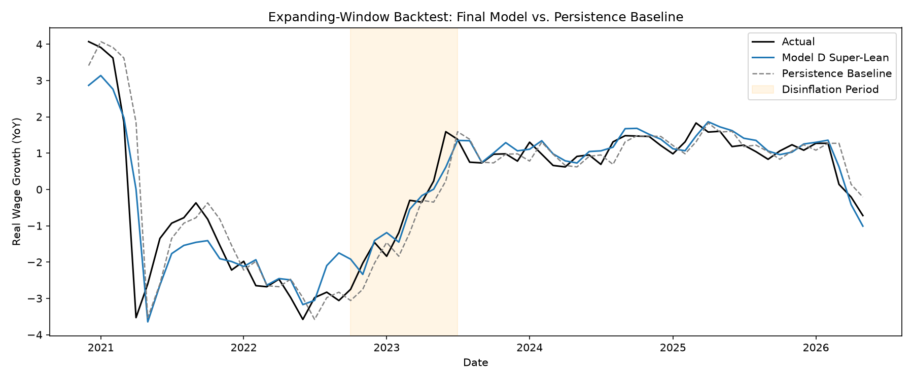

# Real Wage Growth: What Actually Predicts It?

I made an independent project modeling U.S. real wage growth based on data from 2008 to 2026. I wanted to know which macroeconomic variables have the biggest impact, and whether a model can beat the simplest possible (naive) forecast: "next month looks like this month."

The short answer is that gas prices and last month's real wage growth matter, and a 2022-2023 disinflation regime is worth modeling explicitly. A model built on those three beats the naive forecast on paper, but the margin is small, mainly comes from one month (April 2021), and mostly disappears when the model only uses last month's gas price.

## Data
The data is made up of ten macro series, mostly monthly with a few weekly and daily ones worked into the monthly grid: CPI, gas prices, unemployment, disposable income, consumer spending, mortgage rates, the effective fed funds rate, consumer sentiment, hourly wages, and the personal savings rate. All were cleaned in Python, then joined and feature-engineered in MySQL. The target is RealWageGrowth: year-over-year wage growth minus year-over-year inflation.

`data/` keeps every stage so the pipeline can be rerun from scratch:
- `raw/`: the original source files, untouched
- `cleaned/`: each series cleaned on its own (`01_data_cleaning.ipynb`)
- `processed/`: joined, feature-engineered, and the final modeling dataset

### Sources
Everything came from FRED (Federal Reserve Bank of St. Louis). The column name in each raw file is the FRED series ID.

| File | Series | What it is | Originating source |
|---|---|---|---|
| `cpi.csv` | [CPIAUCSL](https://fred.stlouisfed.org/series/CPIAUCSL) | CPI, all urban consumers | Bureau of Labor Statistics |
| `hourly_wages.csv` | [CES0500000003](https://fred.stlouisfed.org/series/CES0500000003) | Average hourly earnings, total private | Bureau of Labor Statistics |
| `unemployment.csv` | [UNRATE](https://fred.stlouisfed.org/series/UNRATE) | Unemployment rate | Bureau of Labor Statistics |
| `real_dpi.csv` | [A229RX0](https://fred.stlouisfed.org/series/A229RX0) | Real disposable personal income per capita | Bureau of Economic Analysis |
| `real_pce.csv` | [PCEC96](https://fred.stlouisfed.org/series/PCEC96) | Real personal consumption expenditures | Bureau of Economic Analysis |
| `personal_savings_rate.csv` | [PSAVERT](https://fred.stlouisfed.org/series/PSAVERT) | Personal saving rate | Bureau of Economic Analysis |
| `gas_prices.csv` | [GASREGW](https://fred.stlouisfed.org/series/GASREGW) | Regular gas price, weekly | Energy Information Administration |
| `EFFR.csv` | [EFFR](https://fred.stlouisfed.org/series/EFFR) | Effective federal funds rate, daily | Federal Reserve Bank of New York |
| `mortgage_rates.csv` | [MORTGAGE30US](https://fred.stlouisfed.org/series/MORTGAGE30US) | 30-year fixed mortgage rate, weekly | Freddie Mac |
| `consumer_sentiment.csv` | [UMCSENT](https://fred.stlouisfed.org/series/UMCSENT) | Consumer sentiment index | University of Michigan |

Most of this is public U.S. government data. The mortgage rate and consumer sentiment series are copyrighted, and FRED asks for these citations:

- Freddie Mac, 30-Year Fixed Rate Mortgage Average in the United States [MORTGAGE30US], retrieved from FRED, Federal Reserve Bank of St. Louis. Data provided "as is" by Freddie Mac with no warranties of any kind.
- Surveys of Consumers, University of Michigan, University of Michigan: Consumer Sentiment © [UMCSENT], retrieved from FRED, Federal Reserve Bank of St. Louis.

The MIT license covers my code, not the data.

## How This Was Built
I tested every series for stationarity (ADF) early in the exploratory data analysis. I ended up creating two models: a plain OLS model (Model A) to interpret the coefficients, and a separate AR-augmented model (using last month's target value) for forecasting. Trying to make one model aimed at forecasting and interpretation didn't work.

HAC standard errors then corrected for the autocorrelation Durbin-Watson found, and Breusch-Godfrey took over as the check once last month's value was a predictor. Breusch-Pagan tested for uneven error variance, while a Ramsey RESET test plus a Random Forest/Gradient Boosting comparison checked whether a linear model was the right tool. Both suggested a linear model was missing something, but I kept it for interpretability. Tradeoff noted under Limitations. 

Tested on an 80/20 time split, Model A's ten worst misses all fell between October 2022 and July 2023, and it over-predicted every one. That lines up with the Fed's rate hikes and the disinflation that followed, so I made this window its own regime. I compared every version with an expanding-window backtest (train on everything up to month t, predict month t+1, repeat). None of the early models beat the persistence baseline until I combined last month's value with the disinflation dummy. Dropping RealMortgageRate and DisposableIncome_YoY, which both failed robustness checks, then gave the final model. 

## How I Used AI
I wrote the data side of this project myself: cleaning each series in Python (`01_data_cleaning.ipynb`), the MySQL joins and feature engineering (`sql/`), and the exploratory analysis (`02_eda.ipynb`).

The modeling stage is where I took advantage of Claude Code. The code in `03_modeling.ipynb` (the diagnostic tests, the model comparisons, the backtest loop) is more advanced than what I can write from scratch right now. Every step worked the same way: I decided what to test, read the output, decided what it meant, and chose what to do next. Each choice in the section above came out of that loop, and nothing went into the final model without me checking it first. I can walk through what each function does, why it's there, and what its output means.

## Final Model
Predictors: `GasPrices_YoY`, `RealWageGrowth_Lag1`, `DisinflationPeriod`

Backtest: 66 out-of-sample months, Dec 2020 to May 2026, spanning the COVID aftermath, the disinflation period, and the 2026 energy shock.

| | RMSE | MAE |
|---|---|---|
| Persistence baseline ("same as last month") | 0.843 | 0.471 |
| Final model | 0.662 | 0.424 |
| Improvement | 21.5% | 10.0% |

It's the only version tested that beat the baseline on both metrics at once, and it beats the baseline both inside and outside the disinflation window when the two are scored separately.

## Limitations
Every number in this section can be reproduced in `03_modeling.ipynb`; the stress-test figures are in its final section.

- Most of the gain comes from April 2021, when April 2020's collapse dropped out of the year-over-year window and persistence missed the jump. That one month is about 91% of the advantage, and without it the improvement is only about 4-5%.
- I picked the disinflation window and the final predictors using the same months the backtest scores, so the backtest isn't fully out of sample.
- The disinflation window starts right where my 80/20 test split began (October 2022), so it could look like an artifact of where training ended. Fit on the full sample with no split, Model A still over-predicts all ten months in the window, missing by 1.8 points on average versus about 0.1 everywhere else, and the window ends with the Fed's last rate hike in July 2023. The exact start and end are a judgment call: moving them by up to three months keeps the RMSE gain between 18% and 24%, though the MAE gain ranges from 3.6% to 13%.
- Year-over-year figures overlap by 11 months, and Breusch-Godfrey still finds autocorrelation in the final model. That probably makes the standard errors too small and may bias the coefficients since last month's value is a predictor.
- RESET rejected linearity, and a Random Forest beat the linear model by 13-15% on one test split. I stuck with linear because I can interpret it and because trees can't predict outside their training range, but a nonlinear model might still forecast better.
- Gas is part of CPI, which feeds straight into real wage growth, so part of the gas relationship is mechanical. The model also uses same-month gas prices, so it's closer to a nowcast than a true forecast. Swapping in last month's gas price, which makes it a true forecast, cuts the gain to about 6% on RMSE and nearly zero on MAE.

## Reproducing It
Requires Python 3.12 or newer. Install the packages with `pip install -r requirements.txt`.

1. Run `notebooks/01_data_cleaning.ipynb`. This cleans each raw series and writes the outputs to `data/cleaned/`.
2. Load `data/cleaned/` into MySQL, then run `sql/01_build_master_monthly.sql` followed by `sql/02_engineer_features.sql` to join and feature-engineer the series.
3. Export the result as `data/processed/master_monthly_features.csv` (semicolon-delimited). Early 2007 values that lack a full year of prior data were exported as `0.0` instead of blank, and `02_eda.ipynb` removes those rows before any analysis.
4. Run `notebooks/02_eda.ipynb`.
5. Run `notebooks/03_modeling.ipynb`, which produces the final model and the expanding-window backtest.

## Structure
- `sql/`: MySQL build and feature engineering
- `notebooks/`: cleaning, EDA, modeling
- `data/`: raw, cleaned, and processed data (see Data above)
- `docs/`: figures

## Tools
Python (pandas, statsmodels, scikit-learn), MySQL, Google Colab, Claude Code (modeling stage)

